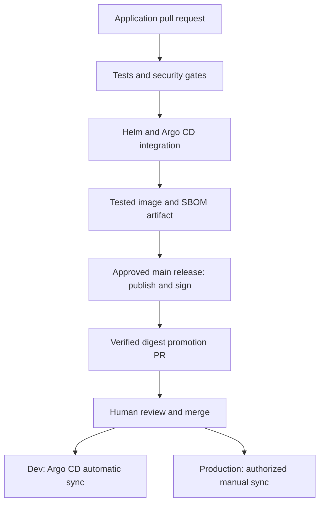

# Helm and GitOps application delivery

This repository contains a small stateless Python API, a Helm chart, an application
security pipeline, and Argo CD desired-state definitions. It is an executable
reference with recorded test boundaries, not a claim of production adoption.

## Responsibilities

| Component | Responsibility | What it does not receive |
| --- | --- | --- |
| Application CI | Tests, Bandit, dependency audit, Gitleaks, Helm/schema/IaC checks, container scanning, SPDX SBOM, runtime and passive DAST | AWS credentials, production kubeconfig, repository write token |
| Release workflow | Accept only successful main/push CI; publish the tested image artifact; keyless-sign image and attest SBOM | Permission to change GitOps values or sync production |
| Promotion workflow | Verify image signature/SBOM identity; propose a one-environment values PR using a scoped GitHub App | Permission to merge its own PR or contact a production cluster |
| Argo CD | Render the Git Helm source and reconcile desired state | Build or scan privileges |
| Kubernetes admission | Reject mutable image tags and host namespaces in labeled namespaces | A claim that digest format alone proves signature validity |

## CI gates

- Three HTTP unit tests and two promotion-tool tests.
- Bandit medium/high severity and confidence gate. The container bind address is
  a documented, line-scoped exception; other findings are not suppressed globally.
- `pip-audit` evaluates application requirements. The current application has no
  third-party Python runtime packages; this is not presented as a nonempty SCA scan.
- Gitleaks scans the checked-out repository history with redacted output.
- Helm 4 renders dev, production, and optional HPA/Ingress templates. Kubeconform
  validates Kubernetes schemas. Trivy blocks HIGH/CRITICAL workload findings.
- The image is built once from a digest-pinned Python base, scanned without
  ignoring unfixed HIGH/CRITICAL vulnerabilities, and saved with an SPDX SBOM.
- Actionlint checks CI, release, and promotion workflow syntax. Actions are pinned
  to verified commit SHAs; Dependabot proposes updates.
- Runtime testing uses an actual image manifest digest in a disposable registry,
  a three-node kind cluster, and Argo CD 3.6.1. An in-cluster read-only Git daemon serves
  the test commits; these are not fake contributions to GitHub history.
- Passive ZAP DAST has explicit failure rules for selected security headers. It is
  not an authenticated penetration test, active DAST, or business-logic assessment.

## First release and promotion

1. Review/merge the code after required CI checks. Configure main branch protection
   with the application CI jobs as required checks and require code-owner review.
2. Create the `release`, `dev-promotion`, and `production-promotion` environments.
   Configure reviewers and protected-main restrictions. Set `RELEASE_GUARDS_CONFIRMED`
   or `PROMOTION_GUARDS_CONFIRMED` only after checking those controls. The variables
   are explicit setup acknowledgments, not automatic verification of GitHub settings.
3. Set up a promotion GitHub App installed only on this repository, granting contents
   and pull-request write. Store its client ID as `PROMOTION_APP_CLIENT_ID` and key
   as `PROMOTION_APP_PRIVATE_KEY` in the promotion environments. Tokens are narrowed
   to the current repository and revoked after the job. App-generated PRs can trigger
   CI; GitHub's default token suppresses many recursive workflow events.
4. Dispatch `Publish verified application digest` from main using a completed,
   successful main-branch **push** run ID for `DevSecOps Application CI`. PR or fork
   runs are rejected. The tested image is loaded from that CI artifact, not rebuilt.
5. Configure GHCR package access. Packages need not be public. Production clusters
   pulling a private package need an externally managed read-only pull secret; add
   only its name to Helm `imagePullSecrets`, never its credentials to Git.
6. Dispatch `Propose GitOps promotion` with the signed `@sha256:` reference, source
   version, and target environment. The workflow verifies the expected GitHub
   workflow identity and SBOM attestation before opening a PR. It never auto-merges.
7. Review the values-only diff and CI results. Dev syncs automatically after merge.
   Production remains manual-sync and requires a separately authorized Argo CD user.

The initial all-zero digest is a visible, unpromoted sentinel, not a runnable
release. The promotion tool rejects it. Bootstrap a real signed release before
applying the committed Application definitions to a persistent cluster.

Cosign keyless signing records identity metadata in public transparency services.
Organizations requiring private transparency need a separate trust deployment.
No production signing, registry publication, or real-cluster bootstrap is claimed
until those configured workflows are actually executed and verified.

## Cluster bootstrap

Install the reviewed Argo CD version and namespace-scoped repository credentials
through the approved secret process. Apply namespaces and the admission policy
from `gitops/bootstrap`, then the scoped projects and applications. Dev and production
share the in-cluster API endpoint in this reference; a real trust boundary may need
separate clusters/controllers and independently restricted credentials.

AppProjects allow only this source repository, their destination namespace, and
listed namespaced resource kinds. They do not grant Helm releases cluster-admin
or permission to create namespaces/RBAC. Cluster bootstrap remains an admin task.

NetworkPolicy is default-deny egress for this dependency-free API, with ingress
from the ingress-controller namespace. The test's kindnet CNI does not prove
NetworkPolicy enforcement. Validate deny/allow behavior with your production CNI.
HPA rendering is tested; real HPA load behavior is not tested by the default runtime.
Ingress rendering includes TLS; real DNS, certificates, ingress routing and WAF
are environment-specific acceptance checks.

## Rollback and operations

Revert the environment promotion commit in Git and review the rollback PR. Argo CD
will reconcile the prior digest/configuration. Manual `kubectl rollout undo` is not
persistent under self-healing. A bad digest in the runtime exercise is rolled back
through a real Git revert in the isolated test repository.

Keep immutable release artifacts and their CI/SBOM/signature evidence, define
service-specific SLOs and paging, and practice response before production use.
The workflows do not claim organizational controls exist simply because YAML is present.
